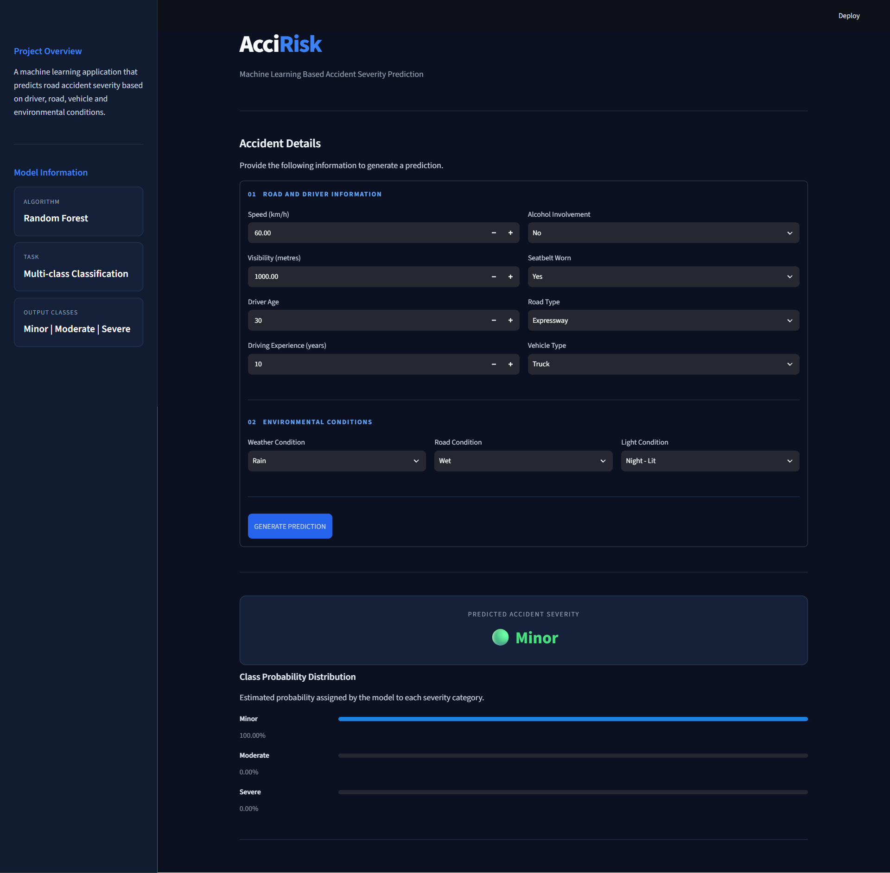
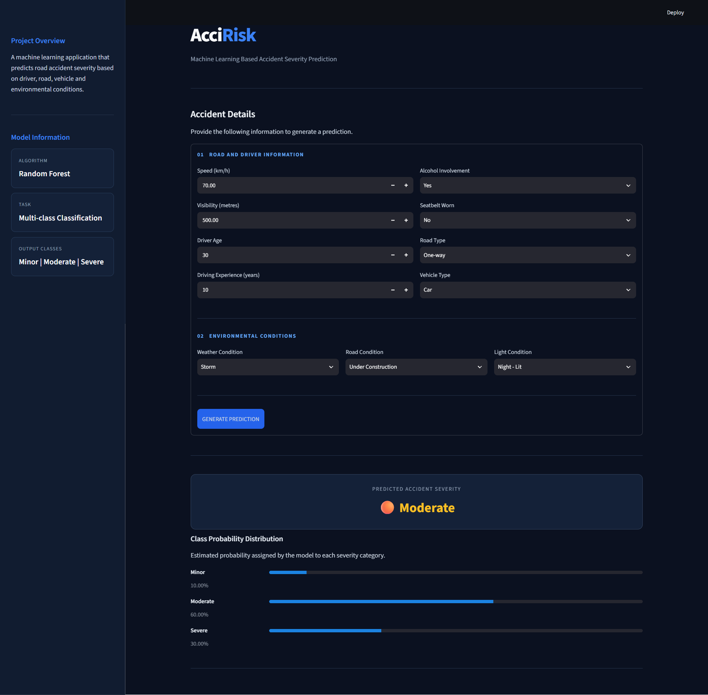
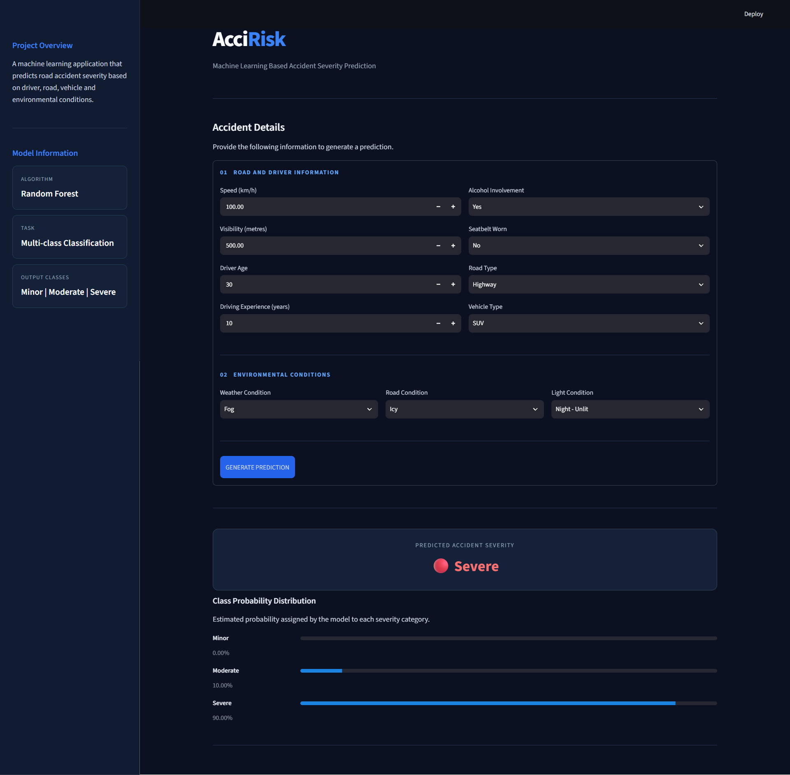

# Accident Severity Prediction

A machine learning project that predicts road accident severity based on accident-related conditions. This project covers data preprocessing, exploratory data analysis, model building, evaluation, and deployment using Streamlit.

## Project Overview

Road accidents can have different levels of severity depending on several contributing factors. This project uses machine learning classification algorithms to predict accident severity based on the available accident-related features.

The target variable contains three categories:

- Minor
- Moderate
- Severe

## Dataset

- **Initial records:** 8,400
- **Records after cleaning:** 8,000
- **Problem type:** Multiclass Classification
- **Target variable:** `accident_severity`

The dataset includes accident-related features such as vehicle speed, visibility, and other road and environmental conditions.

## Project Workflow

### 1. Data Cleaning
- Removed irrelevant and redundant columns.
- Handled missing values.
- Identified and removed duplicate records.

### 2. Exploratory Data Analysis
- Analysed the distribution of accident severity.
- Explored relationships between accident conditions and severity.
- Used visualisations to identify patterns in the dataset.

### 3. Data Preprocessing
- Converted categorical variables into numerical representations.
- Separated features and target variable.
- Performed stratified train-test splitting.

### 4. Model Building

The following classification algorithms were implemented:

- Decision Tree
- Naive Bayes
- Logistic Regression
- Support Vector Machine (SVM)
- Random Forest

### 5. Model Evaluation

The models were evaluated using test accuracy to compare their classification performance.

## Model Performance

| Model | Test Accuracy |
|---|---:|
| Random Forest | 95.7% |
| Decision Tree | 94.3% |
| Logistic Regression | 93.8% |
| Support Vector Machine | 92.9% |
| Naive Bayes | 90.6% |

Random Forest achieved the highest test accuracy among the evaluated models.

## Key Findings

- Visibility and vehicle speed were the most influential features in the Random Forest model.
- Lower visibility and higher vehicle speed were associated with more severe accident categories in this dataset.
- Random Forest achieved the highest test accuracy among the evaluated models.

## Streamlit Application

The trained Random Forest model is integrated into a Streamlit application. Users can enter accident-related details and receive a predicted accident severity category.

## Screenshots

### Minor Accident Prediction



### Moderate Accident Prediction



### Severe Accident Prediction



## Technologies Used

- **Programming Language:** Python
- **Data Analysis:** Pandas, NumPy
- **Data Visualisation:** Matplotlib, Seaborn
- **Machine Learning:** Scikit-learn
- **Web Application:** Streamlit
- **Model Serialization:** Pickle

## Project Structure

```text
Accident-Severity-Prediction/
│
├── data/
│   └── traffic_accident_dataset.csv
│
├── models/
│   └── rf_model.pkl
│
├── screenshots/
│   ├── minor.png
│   ├── moderate.png
│   └── severe.png
│
├── app.py
├── data.ipynb
├── requirements.txt
├── README.md
└── .gitignore
```

## How to Run Locally

### 1. Clone the repository

```bash
git clone https://github.com/sangeerthana03/AcciRisk-Accident-Severity-Prediction.git
```

### 2. Navigate to the project directory

```bash
cd Accident-Severity-Prediction
```

### 3. Create a virtual environment

```bash
python -m venv .venv
```

### 4. Activate the virtual environment

Windows:

```bash
.venv\Scripts\activate
```

### 5. Install dependencies

```bash
python -m pip install -r requirements.txt
```

### 6. Run the application

```bash
python -m streamlit run app.py
```

## Disclaimer

This project is developed for educational purposes. Predictions are based on the dataset used for training and should not be considered a substitute for real-world road safety assessments.